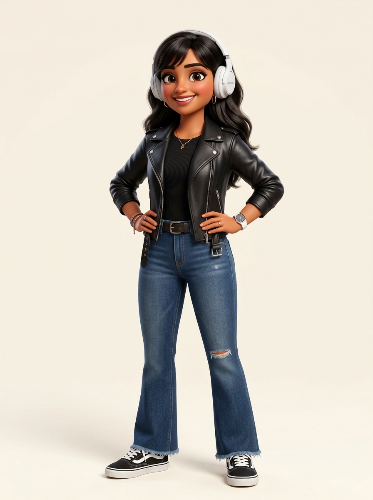

# Lipi Roy — Personal Website & Journal

[](https://portfolio-alpha-swart-fea1831x8x.vercel.app/)

> 🌐 **[portfolio-alpha-swart-fea1831x8x.vercel.app](https://portfolio-alpha-swart-fea1831x8x.vercel.app/)**

A personal corner of the internet exploring software, cinema, music, and the person I am becoming. Built with **React** and **Vite**, preserving the editorial publication aesthetic, cream palette, and typography from the original design.



---

## 🎞️ What Lives Here

- **Hero**: *"Somewhere between logic and imagination."* — pairing structured frontend logic with the stories, cinema, and curiosity that shape who I am.
- **Selected Work (`#work`)**: Real technical projects including **Cinematch** (movie discovery & taste DNA), **GeneWise** (hereditary health risk estimator), **AquaTrace** (water purity monitoring), and **MemeGenerator** (lightweight canvas utility).
- **About (`#about`)**: An authentic look at an IT student learning to build with logic while making room for everything that refuses to be explained by it.
- **Toolkit & Skills (`#skills`)**: Tools for building, mediums for thinking. A grounded look at core web languages, algorithmic problem solving, and design craft.
- **Frames I Can't Forget (`#beyond`)**: A personal film journal focusing on cinematography, atmosphere, and visual composition. Features *Carol (2015)*, *Portrait of a Lady on Fire (2019)*, and *Eternal Sunshine of the Spotless Mind (2004)* with editable personal reflections and a direct link to my [Letterboxd](https://letterboxd.com/LIPISTICK/).
- **On Repeat (`#beyond`)**: A subtle music corner with songs for the moments that don't need explaining.
- **Find Me Elsewhere (`#contact`)**: Direct communication via email ([lipiroyyy68@gmail.com](mailto:lipiroyyy68@gmail.com)), plus GitHub, LinkedIn, Letterboxd, and Instagram.

---

## 📂 Project Architecture

```text
portfolio/
├── public/
│   ├── avatar.png          # 3D cartoon avatar asset
│   └── favicon.svg         # Editorial monogram favicon
├── src/
│   ├── components/
│   │   ├── Navbar.jsx      # Navigation header with spaced 'l i p i' brand mark
│   │   ├── Hero.jsx        # Editorial hero section
│   │   ├── About.jsx       # '02 / ABOUT ME' personal story & pillars
│   │   ├── Projects.jsx    # '03 / SELECTED WORK' real project cards & details
│   │   ├── Skills.jsx      # '04 / TOOLKIT & SKILLS' technical & creative toolkit
│   │   ├── BeyondCode.jsx  # '05 / BEYOND CODE' Frames I Can't Forget & On Repeat
│   │   ├── Contact.jsx     # '06 / GET IN TOUCH' real links & mailto
│   │   └── Footer.jsx      # Minimalist footer with working back-to-top button
│   ├── data/
│   │   ├── projectsData.js # Real project descriptions & GitHub repo links
│   │   ├── filmsData.js    # Film journal entries & reflections
│   │   ├── musicData.js    # On Repeat music tracks & personal notes
│   │   └── skillsData.js   # Technical & creative capabilities
│   ├── App.jsx             # Main page assembly
│   ├── index.css           # Editorial typography & design system tokens
│   └── main.jsx            # React root
├── index.html              # HTML shell with Google Fonts
├── package.json            # Scripts & dependencies
└── vite.config.js          # Vite config
```

---

## 🚀 How to Run Locally

### 1. Prerequisites
Ensure you have **Node.js** installed on your machine.

### 2. Open Terminal
Navigate to the project root:
```bash
cd "C:\Users\Lippi Roy\.gemini\antigravity\scratch\portfolio"
```

### 3. Start Development Server
```bash
npm run dev
```
Open **`http://localhost:5173/`** in your browser to view your live personal website. Hot Module Replacement (HMR) updates changes instantly.

### 4. Build for Production
```bash
npm run build
npm run preview
```

---

## ✍️ Adding to Your Film Journal & Music

- **Film Journal**: Open `src/data/filmsData.js` to add new films (title, year, director, cinematographer, palette notes, and your thoughts). You can also click **WRITE NOTE** or **EDIT NOTE** directly on any film card in the browser to save reflections!
- **Music (On Repeat)**: Open `src/data/musicData.js` to add tracks, artists, notes, and streaming links.
- **Projects**: Open `src/data/projectsData.js` to add new repositories as you build them.
